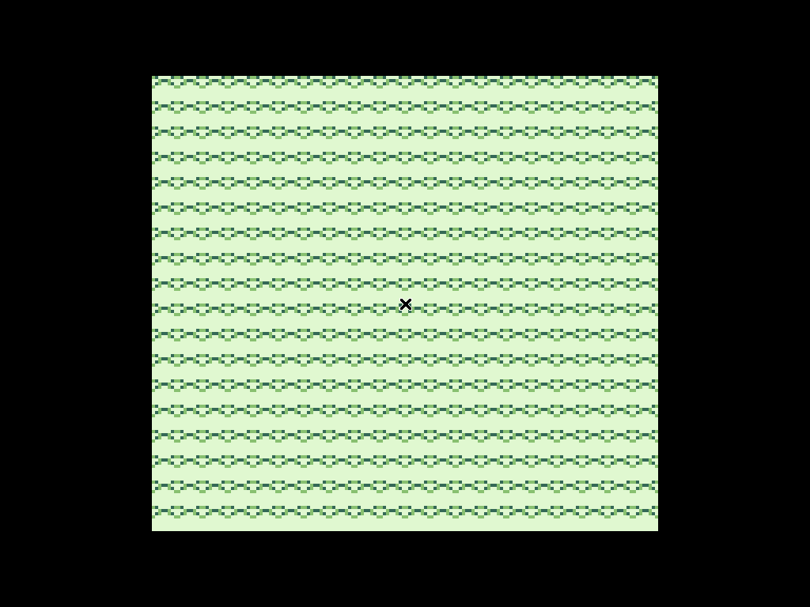

# Educational Game Boy Emulator in C

A small, readable emulator for the original monochrome Nintendo Game Boy (DMG), written in C with SDL2. It is designed as a cybersecurity and systems-programming learning project: the emphasis is on binary data, CPU instruction decoding, memory-mapped I/O, state transitions, and reverse-engineering fundamentals rather than complete commercial-game compatibility.



The built-in demonstration ROM runs without an external cartridge and renders a monochrome tile pattern with a centered marker. This makes it possible to build and visually verify the project immediately after cloning.

## Features

- SM83-style CPU core with algorithmic decoding for the standard and CB-prefixed instruction groups.
- 64 KiB CPU address space with memory-mapped I/O.
- MBC0 and basic MBC1 cartridge bank switching.
- Divider and timer registers.
- Scanline-based PPU renderer for background, window, and basic sprites.
- SDL2 keyboard input and a simplified two-square-wave audio output.
- Built-in educational ROM for demonstrations when no external ROM is supplied.

## Scope and limitations

This is an **educational emulator**, not a cycle-accurate compatibility emulator. It does not implement every hardware quirk, the audio subsystem is intentionally simplified, and cartridge support is limited to MBC0/MBC1. Use only ROMs that you are legally allowed to use.

## Requirements

- C compiler with C11 support (GCC or Clang)
- GNU Make
- SDL2 development libraries
- `pkg-config`

### Ubuntu/Debian

```bash
sudo apt update
sudo apt install build-essential pkg-config libsdl2-dev
```

### Fedora

```bash
sudo dnf install gcc make pkgconf-pkg-config SDL2-devel
```

### Windows with MSYS2 UCRT64

```bash
pacman -S mingw-w64-ucrt-x86_64-gcc \
        mingw-w64-ucrt-x86_64-make \
        mingw-w64-ucrt-x86_64-pkg-config \
        mingw-w64-ucrt-x86_64-SDL2
```

## Build

From the project directory:

```bash
make
```

The default executable is `gameboy`. On Windows, use an `.exe` target if desired:

```bash
make TARGET=gameboy.exe
```

To build without Make, use:

```bash
gcc -std=c11 -Wall -Wextra -Wpedantic -O2 -Isrc \
    $(pkg-config --cflags sdl2) src/*.c \
    -o gameboy $(pkg-config --libs sdl2) -lm
```

## Run

Start the built-in demonstration ROM:

```bash
./gameboy
```

Load an external Game Boy ROM:

```bash
./gameboy path/to/game.gb
```

Controls:

| Keyboard | Game Boy control |
|---|---|
| Arrow keys or WASD | D-pad |
| Z | B |
| X | A |
| Backspace | Select |
| Enter | Start |
| Escape | Quit |

## Project layout

- `src/cpu.c/.h` — registers, fetch/decode/execute, flags, stack, and interrupts.
- `src/bus.c/.h` — CPU memory reads/writes and memory-mapped hardware.
- `src/cartridge.c/.h` — ROM loading and basic MBC0/MBC1 banking.
- `src/ppu.c/.h` — LCD timing and pixel rendering.
- `src/input.c/.h` — SDL keyboard-to-joypad mapping.
- `src/apu.c/.h` — simplified audio generation.
- `src/timer.c/.h` — DIV/TIMA/TMA/TAC behavior.
- `src/main.c` — SDL window, main loop, and subsystem integration.
- `docs/` — architecture notes, presentation material, and study guide.

## Core emulation loop

Each iteration advances the virtual hardware from a shared emulated clock:

1. The CPU fetches and executes one instruction.
2. The instruction reports the number of CPU cycles it consumed.
3. The timer and PPU advance by the same number of cycles.
4. SDL events update the joypad state.
5. When a frame is complete, the framebuffer is copied to the SDL texture.

This is the central emulator concept: independent virtual devices remain synchronized by the same clock.

## Cybersecurity connection

The security connection is methodological rather than claiming that the emulator is itself a security control. Building an emulator requires reasoning about binary formats, machine instructions, memory addresses, state transitions, I/O interfaces, debugging, and reverse engineering. Those same low-level skills are used when analyzing binaries, understanding attack surfaces, and investigating how software interacts with hardware.

## Suggested presentation demo

1. Run the program without a ROM and show the built-in tile demo.
2. Explain the register state and fetch/decode/execute loop in `src/cpu.c`.
3. Show `src/bus.c` and explain why addresses such as `0xFF00` are hardware registers rather than ordinary RAM.
4. Show `src/ppu.c` and explain tiles, VRAM, scanlines, and the 160×144 framebuffer.
5. Press keys to demonstrate the joypad.
6. Explain why the audio implementation is simplified and what a fully accurate APU would require.

## References

- [Pan Docs](https://gbdev.io/pandocs/)
- [Game Boy opcode reference](https://gbdev.io/gb-opcodes/optables/)
- [GB ASM Tutorial](https://gbdev.io/gb-asm-tutorial/)
- [RGBDS documentation](https://rgbds.gbdev.io/)
- [Cinoop article](https://cturt.github.io/cinoop.html)
- [Cinoop source repository](https://github.com/CTurt/Cinoop)
